# Class Diagram — SIP-MBG Posyandu Melati RW 03

```plantuml
@startuml
skinparam classAttributeIconSize 0
skinparam class {
  BackgroundColor White
  BorderColor Black
  ArrowColor Black
}

' ─────────────────────────────────────────────
' ENUMERATIONS
' ─────────────────────────────────────────────

enum UserRole {
  petugas
  bidan
  kader
  warga
}

enum Gender {
  L
  P
}

enum StatusKMS {
  N
  T
  2T
  BGM
  O
  B
}

enum StatusGiziBBU {
  Gizi_Buruk
  Gizi_Kurang
  Gizi_Baik
  Risiko_Lebih
}

enum StatusGiziTBU {
  Sangat_Pendek
  Pendek
  Normal
  Tinggi
}

enum StatusGiziBBTB {
  Gizi_Buruk_Wasting
  Gizi_Kurang
  Normal
  Beresiko_Obesitas
}

enum StatusGiziLansia {
  Kurus
  Normal
  Kelebihan_Berat
  Obesitas
}

enum StatusTensi {
  Hipotensi
  Normal
  Pre_Hipertensi
  Hipertensi
}

enum StatusGulaDarah {
  Normal
  Pre_Diabetes
  Tinggi_Diabetes
}

enum PrioritasMBG {
  Sangat_Mendesak
  Prioritas_Tinggi
  Prioritas_Sedang
  Pemantauan_Rutin
}

enum KategoriMenu {
  Balita_Gizi_Kurang
  Balita_Stunting
  Bumil_KEK
  Busui_Gizi_Tambahan
  Lansia_Gizi_Khusus
  Gizi_Seimbang_Umum
}

enum TargetSasaran {
  Balita
  Bumil
  Busui
  Lansia
  Semua
}

' ─────────────────────────────────────────────
' ENTITY CLASSES
' ─────────────────────────────────────────────

class Profiles {
  +id : UUID
  +nama : string
  +email : string
  +role : UserRole
  +noHp : string
  +posyandu : string
  +createdAt : datetime
  +updatedAt : datetime
}

class Balita {
  +id : string
  +nik : string
  +nama : string
  +jenisKelamin : Gender
  +tanggalLahir : string
  +namaIbu : string
  +namaAyah : string
  +alamat : string
  +rt : string
  +rw : string
  +posyandu : string
  +noHp : string
  +desilEkonomi : number
  +statusBansos : boolean
  +createdAt : string
}

class PemeriksaanBalita {
  +id : string
  +balitaId : string
  +tanggalPeriksa : string
  +usiaBulan : number
  +beratBadan : number
  +tinggiBadan : number
  +lingkarKepala : number
  +caraUkur : string
  +zScoreBBU : number
  +zScoreTBU : number
  +zScoreBBTB : number
  +statusBBU : StatusGiziBBU
  +statusTBU : StatusGiziTBU
  +statusBBTB : StatusGiziBBTB
  +statusKMS : StatusKMS
  +kenaikanBB : number
  +kbm : number
  +vitaminA : boolean
  +obatCacing : boolean
  +imunisasi : string
  +keluhan : string
  +catatanKader : string
}

class IbuHamil {
  +id : string
  +nik : string
  +nama : string
  +tanggalLahir : string
  +namaSuami : string
  +alamat : string
  +posyandu : string
  +noHp : string
  +hpht : string
  +hpl : string
  +usiaKehamilanMinggu : number
  +gravida : number
  +partus : number
  +abortus : number
  +lilaAwal : number
  +lilaSaatIni : number
  +hb : number
  +statusKEK : boolean
  +statusAnemia : boolean
  +desilEkonomi : number
  +bukuKIA : boolean
  +konsumsiTTD : number
}

class IbuMenyusui {
  +id : string
  +nik : string
  +nama : string
  +tanggalLahir : string
  +namaSuami : string
  +alamat : string
  +posyandu : string
  +noHp : string
  +namaBayi : string
  +usiaBayiBulan : number
  +statusAsiEksklusif : boolean
  +lila : number
  +statusKEK : boolean
  +vitaminANifas : boolean
  +konsumsiTTD : number
  +keluhan : string
  +desilEkonomi : number
  +createdAt : string
}

class Lansia {
  +id : string
  +nik : string
  +nama : string
  +jenisKelamin : Gender
  +tanggalLahir : string
  +usiaTahun : number
  +namaKeluarga : string
  +alamat : string
  +noHp : string
  +posyandu : string
  +golonganDarah : string
  +riwayatPenyakit : string[]
  +createdAt : string
}

class PemeriksaanLansia {
  +id : string
  +lansiaId : string
  +tanggalPeriksa : string
  +beratBadan : number
  +tinggiBadan : number
  +imt : number
  +statusGizi : StatusGiziLansia
  +tensiSistolik : number
  +tensiDiastolik : number
  +statusTensi : StatusTensi
  +gulaDarah : number
  +statusGulaDarah : StatusGulaDarah
  +kolesterol : number
  +asamUrat : number
  +keluhan : string
  +tindakanEdukasi : string
  +petugas : string
}

class MenuMBG {
  +id : string
  +namaMenu : string
  +kategori : KategoriMenu
  +targetSasaran : TargetSasaran
  +deskripsi : string
  +komposisi : string[]
  +kalori : number
  +protein : number
  +zatBesi : number
  +anjuranPemberian : string
}

class DistribusiMBG {
  +id : UUID
  +tanggal : date
  +sasaranId : UUID
  +namaSasaran : string
  +jenisSasaran : TargetSasaran
  +menuId : UUID
  +namaMenu : string
  +porsi : number
  +skorSAW : number
  +ranking : number
  +prioritas : PrioritasMBG
  +keterangan : string
  +petugas : string
  +statusKonsumsi : string
  +evaluasiBB : number
}

class LandingGaleri {
  +id : UUID
  +src : string
  +alt : string
  +urutan : number
  +isActive : boolean
  +createdAt : datetime
}

class LandingJadwal {
  +id : UUID
  +sessionDate : number
  +sessionMonth : string
  +sessionYear : number
  +sessionDayName : string
  +sessionTime : string
  +sessionLocation : string
  +address : string
  +targetSummary : string
  +contactPersonName : string
  +contactWhatsapp : string
  +isActive : boolean
  +createdAt : datetime
  +updatedAt : datetime
}

' ─────────────────────────────────────────────
' VALUE OBJECTS / DTO
' ─────────────────────────────────────────────

class KMSStatusDetail {
  +kode : StatusKMS
  +nama : string
  +arti : string
  +warnaBadge : string
  +warnaTeks : string
  +tindakan : string
}

class RekomendasiResult {
  +sasaranId : string
  +nama : string
  +jenisSasaran : string
  +usia : string
  +posyandu : string
  +skorPreferensi : number
  +rank : number
  +prioritas : PrioritasMBG
  +alasanKlinis : string[]
  +indikatorKunci : IndikatorKunci
  +rekomendasiMenu : MenuMBG
  +terpilihMBG : boolean
}

class IndikatorKunci {
  +zScoreBBU : number
  +statusKMS : StatusKMS
  +lila : number
  +hb : number
  +tensi : string
  +gulaDarah : number
  +desilEkonomi : number
}

class SAWStepDetail {
  +kriteria : SAWCriterion[]
  +alternatif : string[]
  +matriksKeputusan : number[][]
  +matriksNormalisasi : number[][]
  +matriksTerbobot : number[][]
  +skorAkhir : SkorAkhirItem[]
}

class SkorAkhirItem {
  +id : string
  +nama : string
  +skor : number
  +rank : number
}

' ─────────────────────────────────────────────
' SERVICE CLASSES
' ─────────────────────────────────────────────

class PosyanduStore <<service>> {
  +{static} syncFromSupabase() : Promise<void>
  ..Balita..
  +{static} getBalita() : Balita[]
  +{static} saveBalita(list : Balita[]) : void
  +{static} addBalita(item : Balita) : void
  +{static} updateBalita(updated : Balita) : void
  +{static} deleteBalita(id : string) : void
  ..PemeriksaanBalita..
  +{static} getPemeriksaan() : PemeriksaanBalita[]
  +{static} savePemeriksaan(list : PemeriksaanBalita[]) : void
  +{static} addPemeriksaan(item : PemeriksaanBalita) : void
  ..IbuHamil..
  +{static} getBumil() : IbuHamil[]
  +{static} saveBumil(list : IbuHamil[]) : void
  +{static} addBumil(item : IbuHamil) : void
  +{static} updateBumil(updated : IbuHamil) : void
  +{static} deleteBumil(id : string) : void
  ..IbuMenyusui..
  +{static} getBusui() : IbuMenyusui[]
  +{static} saveBusui(list : IbuMenyusui[]) : void
  +{static} addBusui(item : IbuMenyusui) : void
  +{static} updateBusui(updated : IbuMenyusui) : void
  +{static} deleteBusui(id : string) : void
  ..Lansia..
  +{static} getLansia() : Lansia[]
  +{static} saveLansia(list : Lansia[]) : void
  +{static} addLansia(item : Lansia) : void
  +{static} updateLansia(updated : Lansia) : void
  +{static} deleteLansia(id : string) : void
  ..PemeriksaanLansia..
  +{static} getPemeriksaanLansia() : PemeriksaanLansia[]
  +{static} savePemeriksaanLansia(list : PemeriksaanLansia[]) : void
  +{static} addPemeriksaanLansia(item : PemeriksaanLansia) : void
  ..MenuMBG..
  +{static} getMenuMBG() : MenuMBG[]
}

class LandingStore <<service>> {
  +{static} syncFromSupabase() : Promise<void>
  +{static} getGalleryImages() : LandingGaleri[]
  +{static} addGalleryPhoto(src : string) : LandingGaleri[]
  +{static} deleteGalleryPhoto(id : string) : LandingGaleri[]
  +{static} resetGalleryPhotos() : LandingGaleri[]
  +{static} getSchedule() : LandingJadwal
  +{static} saveSchedule(partial : Partial<LandingJadwal>) : LandingJadwal
  +{static} resetSchedule() : LandingJadwal
}

class MCDMEngine <<service>> {
  +{static} KRITERIA_MBG : SAWCriterion[]
  +{static} calculateSAW(candidates : CandidateItem[], criteria : SAWCriterion[]) : SAWResult
  -{static} round(num : number, decimals : number) : number
}

class SAWCriterion {
  +kode : string
  +nama : string
  +bobot : number
  +jenis : string
  +deskripsi : string
}

class CandidateItem {
  +id : string
  +nama : string
  +subjek : string
  +posyandu : string
  +usia : string
  +kriteriaValues : Map<string, number>
  +alasanKlinis : string[]
  +rawDetail : Map<string, any>
}

class SAWResult {
  +ranked : SkorAkhirItem[]
  +steps : SAWStepDetail
}

' ─────────────────────────────────────────────
' RELASI ASOSIASI (Database / Domain)
' ─────────────────────────────────────────────

' One-to-many: satu balita punya banyak pemeriksaan
Balita "1" --> "0..*" PemeriksaanBalita : memiliki >

' One-to-many: satu lansia punya banyak pemeriksaan
Lansia "1" --> "0..*" PemeriksaanLansia : memiliki >

' Distribusi merujuk ke MenuMBG
DistribusiMBG "0..*" --> "1" MenuMBG : menggunakan >

' RekomendasiResult membawa MenuMBG
RekomendasiResult "1" *-- "1" MenuMBG : rekomendasiMenu
RekomendasiResult "1" *-- "1" IndikatorKunci : indikatorKunci

' SAWStepDetail membawa daftar kriteria dan skor
SAWStepDetail "1" *-- "0..*" SAWCriterion : kriteria
SAWStepDetail "1" *-- "0..*" SkorAkhirItem : skorAkhir
SAWResult "1" *-- "1" SAWStepDetail : steps

' CandidateItem dipakai MCDMEngine untuk menghasilkan SAWResult
MCDMEngine ..> CandidateItem : <<use>>
MCDMEngine ..> SAWCriterion : <<use>>
MCDMEngine ..> SAWResult : <<create>>

' Service mengakses entity
PosyanduStore ..> Balita : <<manage>>
PosyanduStore ..> PemeriksaanBalita : <<manage>>
PosyanduStore ..> IbuHamil : <<manage>>
PosyanduStore ..> IbuMenyusui : <<manage>>
PosyanduStore ..> Lansia : <<manage>>
PosyanduStore ..> PemeriksaanLansia : <<manage>>
PosyanduStore ..> MenuMBG : <<read>>

LandingStore ..> LandingGaleri : <<manage>>
LandingStore ..> LandingJadwal : <<manage>>

' KMSStatusDetail sebagai lookup untuk StatusKMS
KMSStatusDetail ..> StatusKMS : <<use>>

' Profiles menggunakan UserRole
Profiles --> UserRole

' Enum usage
Balita --> Gender
Lansia --> Gender
PemeriksaanBalita --> StatusKMS
PemeriksaanBalita --> StatusGiziBBU
PemeriksaanBalita --> StatusGiziTBU
PemeriksaanBalita --> StatusGiziBBTB
PemeriksaanLansia --> StatusGiziLansia
PemeriksaanLansia --> StatusTensi
PemeriksaanLansia --> StatusGulaDarah
MenuMBG --> KategoriMenu
MenuMBG --> TargetSasaran
RekomendasiResult --> PrioritasMBG
DistribusiMBG --> PrioritasMBG
DistribusiMBG --> TargetSasaran

@enduml
```

---

## Keterangan Kelas

### Entity Classes (Tabel Database)

| Kelas | Tabel DB | Keterangan |
|-------|----------|------------|
| `Profiles` | `public.profiles` | Akun pengguna sistem (Bidan / Kader) |
| `Balita` | `public.balita` | Data anak usia 0–59 bulan |
| `PemeriksaanBalita` | `public.pemeriksaan_balita` | Rekam timbang bulanan per balita |
| `IbuHamil` | `public.ibu_hamil` | Data ibu hamil beserta status KEK & anemia |
| `IbuMenyusui` | `public.ibu_menyusui` | Data ibu menyusui beserta status KEK |
| `Lansia` | `public.lansia` | Data warga usia ≥ 60 tahun |
| `PemeriksaanLansia` | `public.pemeriksaan_lansia` | Rekam pemeriksaan PTM lansia |
| `MenuMBG` | `public.menu_mbg` | Katalog menu Makanan Bergizi (read-only) |
| `DistribusiMBG` | `public.distribusi_mbg` | Log distribusi & hasil ranking SAW |
| `LandingGaleri` | `public.landing_galeri` | Foto galeri halaman publik |
| `LandingJadwal` | `public.landing_jadwal` | Konfigurasi jadwal posyandu publik |

### Service Classes

| Kelas | Pola | Keterangan |
|-------|------|------------|
| `PosyanduStore` | Static class | CRUD semua entitas klinis, hybrid localStorage + Supabase |
| `LandingStore` | Static object | CRUD galeri & jadwal CMS, hybrid localStorage + Supabase |
| `MCDMEngine` | Static class | Algoritma SAW — normalisasi matriks, hitung V_i, ranking |

### Value Objects / DTO

| Kelas | Keterangan |
|-------|------------|
| `KMSStatusDetail` | Lookup badge & tindakan per status KMS |
| `RekomendasiResult` | Output ranking SAW per sasaran + menu rekomendasi |
| `IndikatorKunci` | Indikator klinis per sasaran untuk RekomendasiResult |
| `SAWStepDetail` | Matriks langkah perhitungan SAW (keputusan, normalisasi, terbobot) |
| `SkorAkhirItem` | Baris skor akhir + rank per kandidat |
| `SAWCriterion` | Definisi kriteria SAW (kode, bobot, jenis benefit/cost) |
| `CandidateItem` | Kandidat penerima MBG sebelum dihitung SAW |
| `SAWResult` | Output `calculateSAW()` — ranked list + steps |

---

## Relasi Utama

| Dari | Ke | Tipe | Keterangan |
|------|----|------|------------|
| `Balita` | `PemeriksaanBalita` | 1 → 0..* | Satu balita punya banyak rekam timbang |
| `Lansia` | `PemeriksaanLansia` | 1 → 0..* | Satu lansia punya banyak rekam PTM |
| `DistribusiMBG` | `MenuMBG` | 0..* → 1 | Setiap distribusi pakai satu menu |
| `RekomendasiResult` | `MenuMBG` | komposisi | Membawa objek menu rekomendasi |
| `RekomendasiResult` | `IndikatorKunci` | komposisi | Membawa indikator klinis |
| `SAWStepDetail` | `SAWCriterion` | komposisi | Membawa daftar kriteria |
| `SAWResult` | `SAWStepDetail` | komposisi | Membawa langkah perhitungan |
| `MCDMEngine` | `CandidateItem` | dependency | Terima kandidat sebagai input |
| `MCDMEngine` | `SAWResult` | dependency | Hasilkan output ranking |
| `PosyanduStore` | Semua entity klinis | dependency | Kelola CRUD via localStorage + Supabase |
| `LandingStore` | `LandingGaleri`, `LandingJadwal` | dependency | Kelola CMS |

---

## Kriteria SAW (`KRITERIA_MBG`)

| Kode | Nama | Bobot | Jenis |
|------|------|-------|-------|
| C1 | Defisit Gizi / Status Nutrisi | 30% | benefit |
| C2 | Tren Pertumbuhan / KMS | 25% | benefit |
| C3 | Komplikasi Fisik / Anemia | 20% | benefit |
| C4 | Kondisi Ekonomi (Desil DTKS) | 15% | benefit |
| C5 | Riwayat Penyakit / Keluhan | 10% | benefit |
