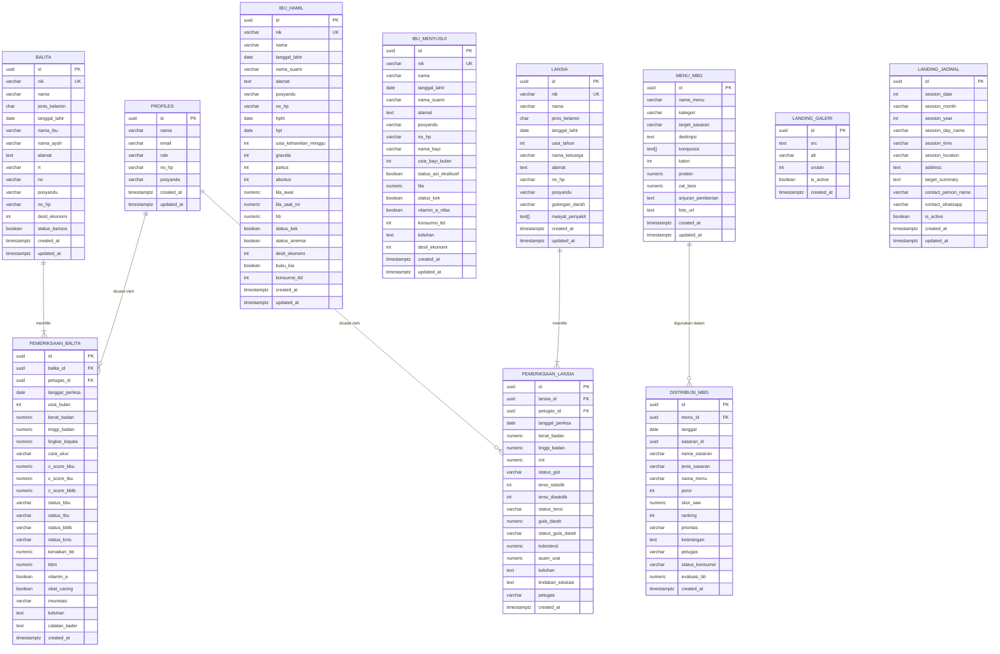

# ERD (Entity Relationship Diagram) — SIP-MBG Posyandu Melati RW 03

> **Notasi ERD (Crow's Foot / IE Notation):**
> - `PK` — Primary Key
> - `FK` — Foreign Key
> - `||--||` — One to One
> - `||--o{` — One to Many (wajib ke opsional banyak)
> - `||--|{` — One to Many (wajib ke wajib banyak)
> - `}o--o{` — Many to Many (opsional)
> - `--` — Garis relasi

---

## Diagram ERD (Mermaid)

---

## Keterangan Entitas

| Entitas | Tabel DB | Keterangan |
|---------|----------|------------|
| `PROFILES` | `public.profiles` | Akun pengguna sistem (Bidan / Kader), terhubung ke Supabase Auth |
| `BALITA` | `public.balita` | Data anak usia 0–59 bulan, NIK unik |
| `PEMERIKSAAN_BALITA` | `public.pemeriksaan_balita` | Rekam timbang bulanan per balita — BB, TB, Z-Score, KMS |
| `IBU_HAMIL` | `public.ibu_hamil` | Data ibu hamil, auto-deteksi KEK (LiLA < 23.5) & anemia (Hb < 11) |
| `IBU_MENYUSUI` | `public.ibu_menyusui` | Data ibu menyusui, auto-deteksi KEK |
| `LANSIA` | `public.lansia` | Data warga usia ≥ 60 tahun |
| `PEMERIKSAAN_LANSIA` | `public.pemeriksaan_lansia` | Rekam pemeriksaan PTM — IMT, tensi, GDS, kolesterol, asam urat |
| `MENU_MBG` | `public.menu_mbg` | Katalog menu Makanan Bergizi (read-only, diisi via seed) |
| `DISTRIBUSI_MBG` | `public.distribusi_mbg` | Log distribusi MBG + hasil ranking SAW per sasaran |
| `LANDING_GALERI` | `public.landing_galeri` | Foto galeri halaman publik (CMS) |
| `LANDING_JADWAL` | `public.landing_jadwal` | Konfigurasi jadwal posyandu halaman publik (CMS) |

---

## Keterangan Relasi

| Dari | Ke | Kardinalitas | Keterangan |
|------|----|--------------|------------|
| `BALITA` | `PEMERIKSAAN_BALITA` | 1 → banyak (wajib) | Satu balita punya banyak rekam timbang. Hapus balita → hapus semua rekam (CASCADE) |
| `LANSIA` | `PEMERIKSAAN_LANSIA` | 1 → banyak (wajib) | Satu lansia punya banyak rekam PTM. Hapus lansia → hapus semua rekam (CASCADE) |
| `MENU_MBG` | `DISTRIBUSI_MBG` | 1 → banyak (opsional) | Satu menu bisa dipakai banyak distribusi. Hapus menu → `menu_id` jadi NULL (SET NULL) |
| `PROFILES` | `PEMERIKSAAN_BALITA` | 1 → banyak (opsional) | Petugas yang mencatat timbang. Hapus profil → `petugas_id` jadi NULL (SET NULL) |
| `PROFILES` | `PEMERIKSAAN_LANSIA` | 1 → banyak (opsional) | Petugas yang mencatat PTM. Hapus profil → `petugas_id` jadi NULL (SET NULL) |

---

## Catatan Desain

| Hal | Penjelasan |
|-----|------------|
| `DISTRIBUSI_MBG.sasaran_id` | Polymorphic — bisa merujuk ID dari `balita`, `ibu_hamil`, `ibu_menyusui`, atau `lansia`. Tidak ada FK constraint karena multi-tabel |
| `IBU_HAMIL` & `IBU_MENYUSUI` | Entitas terpisah, tidak ada relasi langsung ke `BALITA` di DB (relasi logis via NIK ibu di aplikasi) |
| `LANDING_GALERI` & `LANDING_JADWAL` | Berdiri sendiri, tidak berelasi ke entitas klinis manapun |
| `PROFILES` | FK ke `auth.users` Supabase, bukan tabel internal. Hapus user auth → hapus profil (CASCADE) |
| Kolom `status_kek`, `status_anemia` | Dihitung otomatis di aplikasi saat simpan, disimpan redundan di DB untuk query cepat |
