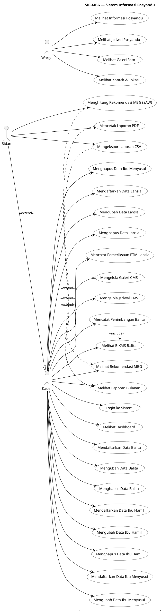

# Use Case Diagram — SIP-MBG Posyandu Melati RW 03

---

## Keterangan Aktor

| Aktor | Deskripsi |
|-------|-----------|
| **Warga** | Masyarakat umum, akses publik tanpa login |
| **Kader** | Petugas posyandu, login wajib, akses operasional penuh |
| **Bidan** | Supervisi klinis, mewarisi semua hak Kader + fitur eksklusif |

> **Relasi generalisasi:** Bidan `--|>` Kader — Bidan memiliki semua use case Kader ditambah use case eksklusif (UC26, UC27, UC28).

---

## Keterangan Use Case

| Kode | Use Case | Aktor |
|------|----------|-------|
| UC01 | Melihat Informasi Posyandu | Warga |
| UC02 | Melihat Jadwal Posyandu | Warga |
| UC03 | Melihat Galeri Foto | Warga |
| UC04 | Melihat Kontak & Lokasi | Warga |
| UC05 | Login ke Sistem | Kader, Bidan |
| UC06 | Melihat Dashboard | Kader, Bidan |
| UC07 | Mendaftarkan Data Balita | Kader, Bidan |
| UC08 | Mengubah Data Balita | Kader, Bidan |
| UC09 | Menghapus Data Balita | Kader, Bidan |
| UC10 | Mencatat Penimbangan Balita | Kader, Bidan |
| UC11 | Melihat E-KMS Balita | Kader, Bidan |
| UC12 | Mendaftarkan Data Ibu Hamil | Kader, Bidan |
| UC13 | Mengubah Data Ibu Hamil | Kader, Bidan |
| UC14 | Menghapus Data Ibu Hamil | Kader, Bidan |
| UC15 | Mendaftarkan Data Ibu Menyusui | Kader, Bidan |
| UC16 | Mengubah Data Ibu Menyusui | Kader, Bidan |
| UC17 | Menghapus Data Ibu Menyusui | Kader, Bidan |
| UC18 | Mendaftarkan Data Lansia | Kader, Bidan |
| UC19 | Mengubah Data Lansia | Kader, Bidan |
| UC20 | Menghapus Data Lansia | Kader, Bidan |
| UC21 | Mencatat Pemeriksaan PTM Lansia | Kader, Bidan |
| UC22 | Melihat Rekomendasi MBG | Kader, Bidan |
| UC23 | Melihat Laporan Bulanan | Kader, Bidan |
| UC24 | Mengelola Galeri CMS | Kader, Bidan |
| UC25 | Mengelola Jadwal CMS | Kader, Bidan |
| UC26 | Menghitung Rekomendasi MBG (SAW) | Bidan |
| UC27 | Mencetak Laporan PDF | Bidan |
| UC28 | Mengekspor Laporan CSV | Bidan |

---

## Relasi

| Relasi | Dari | Ke | Keterangan |
|--------|------|----|------------|
| `<<include>>` | UC10 Mencatat Penimbangan | UC11 Melihat E-KMS | Setiap catat timbang selalu tersedia akses KMS |
| `<<extend>>` | UC26 Hitung SAW | UC22 Lihat Rekomendasi | Bidan bisa eksekusi kalkulasi SAW, Kader hanya lihat hasil |
| `<<extend>>` | UC27 Cetak PDF | UC23 Lihat Laporan | Cetak PDF memperluas fitur lihat laporan |
| `<<extend>>` | UC28 Ekspor CSV | UC23 Lihat Laporan | Ekspor CSV memperluas fitur lihat laporan |
| Generalisasi | Bidan | Kader | Bidan mewarisi semua hak Kader |
